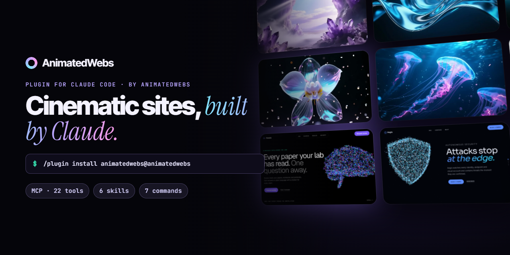
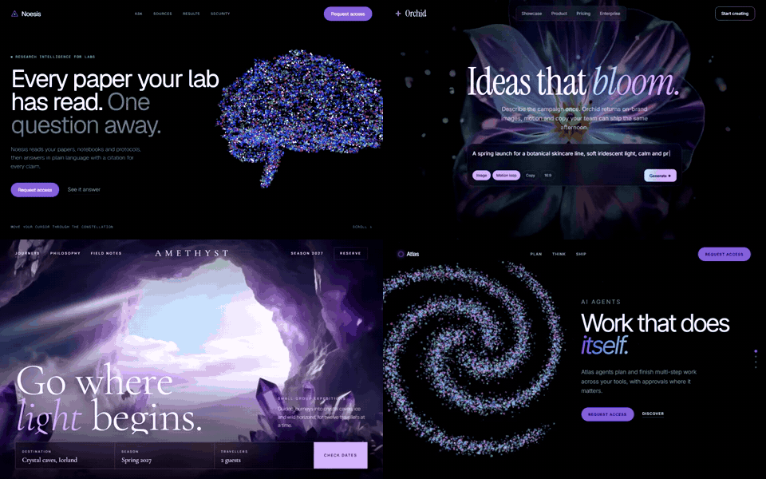
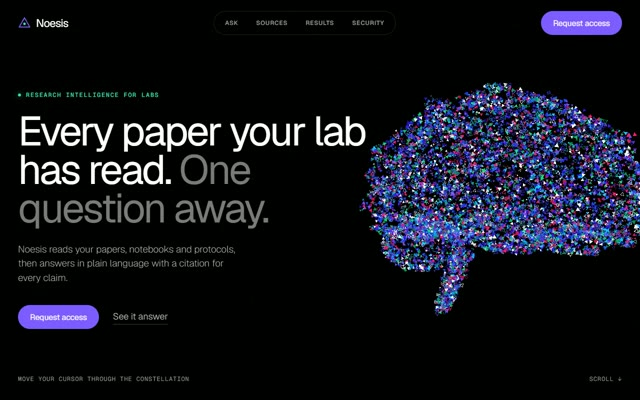
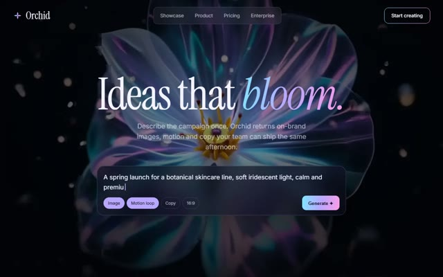
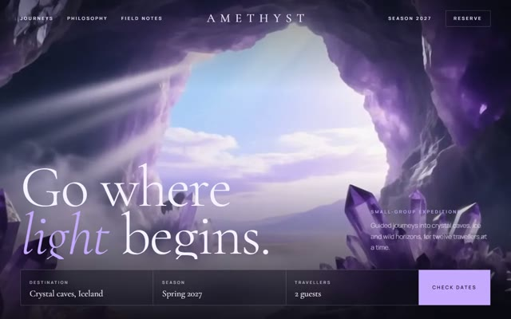
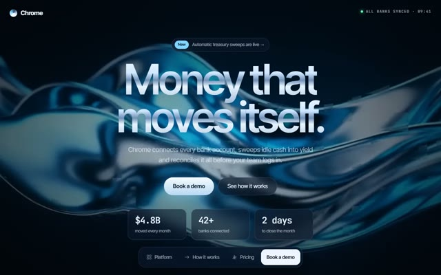
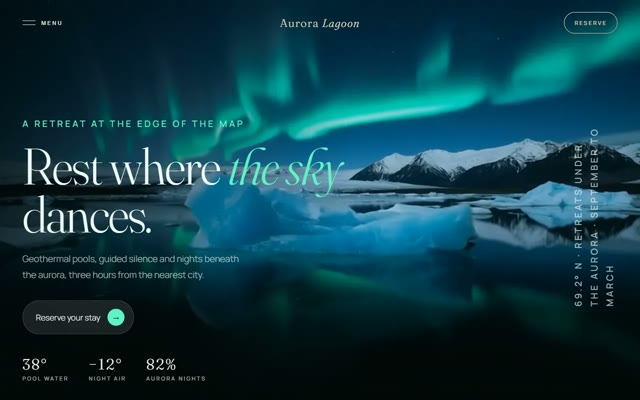
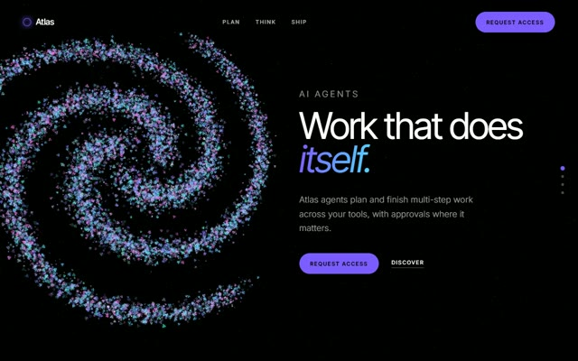

<p align="center">
  <a href="https://animatedwebs.com"></a>
</p>

<p align="center">
  <a href="https://animatedwebs.com/mcp"></a>
  <a href="https://animatedwebs.com/mcp"></a>
  <a href="https://animatedwebs.com/templates"></a>
  <a href=".claude-plugin/marketplace.json"></a>
  <a href="https://animatedwebs.com"></a>
</p>

<p align="center">
  <b>Turn a one-line brief into a production-ready animated website, without leaving Claude Code.</b><br>
  Cinematic templates, live WebGL scenes, video backgrounds, UI components and design systems, delivered through one plugin.
</p>

<p align="center">
  <a href="https://animatedwebs.com">Website</a> ·
  <a href="https://animatedwebs.com/templates">Template library</a> ·
  <a href="https://animatedwebs.com/mcp">Documentation</a> ·
  <a href="https://animatedwebs.com/pricing">Pricing</a> ·
  <a href="https://animatedwebs.com/contact">Support</a>
</p>

<br>

<p align="center">
  <a href="https://animatedwebs.com/templates"></a>
</p>

## Overview

AnimatedWebs is a library of more than 1,200 animated website templates, each with a live demo and a complete build prompt. This plugin connects Claude Code to that library through the AnimatedWebs MCP server and adds skills and commands that know how to use it.

Describe what you need. Claude finds the closest designs, shows you the live demos, and builds the one you choose into your project with its motion, typography and layout intact.

- **Templates.** Full sites and hero sections with scroll storytelling, WebGL, shaders and particle scenes.
- **Cinematic Backgrounds.** Seamless video loops for hero sections, ready to drop in.
- **UI Library.** Animated components with source code, plus AI generation and refinement.
- **Styles.** Design systems as DESIGN.md, Tailwind theme, CSS variables or tokens.
- **Design Studio.** A private design workspace with its own MCP server.

## Installation

In Claude Code, add the marketplace and install the plugin:

```text
/plugin marketplace add iboss21/animatedwebs-claude
/plugin install animatedwebs@animatedwebs
```

The first time a tool runs, Claude Code opens your browser so you can sign in to AnimatedWebs. A free account is enough to get started.

**Using another MCP client?** Connect the server directly:

```bash
claude mcp add --transport http animatedwebs https://mcp.animatedwebs.com
```

Setup guides for Cursor, Codex, VS Code, Windsurf and Antigravity are at [animatedwebs.com/mcp](https://animatedwebs.com/mcp).

## Quick start

Ask in plain language. The right skill takes over:

> *Build a premium landing page for my architecture studio, dark and cinematic.*

> *Give this page a hero with a slow video background, something calm and blue.*

> *Find me a particle scene for an AI product and apply it to my Next.js app.*

## Commands

| Command | Description |
|---|---|
| `/animatedwebs:site <business>` | Selects the best-matching template and builds the complete site |
| `/animatedwebs:browse <style>` | Lists matching templates with links to their live demos |
| `/animatedwebs:hero <idea>` | Replaces the current hero with a cinematic one |
| `/animatedwebs:background <mood>` | Adds a cinematic video background to the hero |
| `/animatedwebs:component <idea>` | Adds an animated UI component from the library, or generates one |
| `/animatedwebs:style <mood>` | Applies a design system as tokens, theme and variables |
| `/animatedwebs:design` | Connects your AnimatedWebs Design Studio workspace |

## Skills

| Skill | Used when you ask to |
|---|---|
| `animatedwebs-site` | build a full website or landing page |
| `animatedwebs-hero` | create or upgrade a hero section |
| `animatedwebs-backgrounds` | add a video or motion background |
| `animatedwebs-components` | add animated UI components |
| `animatedwebs-style` | apply a visual style or design system |
| `animatedwebs-design` | work in Design Studio |

## MCP tools

The server at `https://mcp.animatedwebs.com` exposes 22 tools. Every tool carries MCP annotations (read-only, destructive, open-world) and an icon.

| Area | Tools |
|---|---|
| Templates | `search_templates` · `get_template` · `get_template_prompt` · `list_categories` · `open_in_builder` · `request_template` |
| UI Library | `search_components` · `list_component_categories` · `get_component` · `get_component_source` · `generate_component` · `refine_component` |
| Cinematic Backgrounds | `search_backgrounds` · `get_background` |
| Styles | `search_styles` · `get_style_reference` |
| Design | `get_design_workspace` |
| Account and community | `search_everything` · `get_account` · `get_pricing` · `search_creators` · `get_creator` |

## Featured templates

<table>
  <tr>
    <td width="33%"><a href="https://animatedwebs.com/templates/noesis-research-brain"></a><br><b>Noesis</b><br><sub>WebGL constellation brain · AI / SaaS</sub></td>
    <td width="33%"><a href="https://animatedwebs.com/templates/orchid-ai-studio"></a><br><b>Orchid</b><br><sub>Cinematic video hero · AI studio</sub></td>
    <td width="33%"><a href="https://animatedwebs.com/templates/amethyst-expeditions"></a><br><b>Amethyst</b><br><sub>Cinematic video hero · Travel</sub></td>
  </tr>
  <tr>
    <td width="33%"><a href="https://animatedwebs.com/templates/chrome-capital-fintech"></a><br><b>Chrome Capital</b><br><sub>Liquid chrome film · Fintech</sub></td>
    <td width="33%"><a href="https://animatedwebs.com/templates/aurora-lagoon-retreat"></a><br><b>Aurora Lagoon</b><br><sub>Cinematic video hero · Wellness</sub></td>
    <td width="33%"><a href="https://animatedwebs.com/templates/atlas-ai-agents-scene"></a><br><b>Atlas</b><br><sub>Morphing particle scene · AI agents</sub></td>
  </tr>
</table>

<p align="center"><a href="https://animatedwebs.com/templates"><b>Browse all 1,200+ templates →</b></a></p>

## Plans

| | Free | Pro |
|---|---|---|
| Free templates and prompts | Unlimited | Unlimited |
| Pro templates, backgrounds and component source | | Unlimited |
| AI component generations | 5 a day | 100 a day |
| Design Studio AI requests | 40 a day | 600 a day |
| Commercial licence for client work | | Included |

Pro is $19 a month or $149 a year. One-time Prompt Packs and Lifetime access are also available. See [animatedwebs.com/pricing](https://animatedwebs.com/pricing).

## Security and privacy

- Sign-in uses OAuth in your browser. The plugin stores no passwords or API keys.
- Tools that only read data are marked read-only, so your client can run them without extra prompts.
- Your code stays in your environment. The server returns templates and references; it never reads your project files.

Details are in the [Privacy Policy](https://animatedwebs.com/privacy).

## Support

Questions and account help: [animatedwebs.com/contact](https://animatedwebs.com/contact). Bugs and template requests: [open an issue](https://github.com/iboss21/animatedwebs-claude/issues/new/choose). Security reports: see [SECURITY.md](SECURITY.md). You can also request a template from inside Claude with the `request_template` tool.

## Legal

AnimatedWebs templates, prompts, demos and media are licensed under the [AnimatedWebs Terms](https://animatedwebs.com/terms). The plugin manifest and skills in this repository are provided for use with the AnimatedWebs service.

Release notes are in [CHANGELOG.md](CHANGELOG.md) and the repository licence is in [LICENSE.md](LICENSE.md).

Claude and Claude Code are trademarks of Anthropic, PBC. Other names mentioned belong to their respective owners.

<p align="center"><sub>© 2026 AnimatedWebs</sub></p>
